<p align="center">
  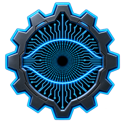
</p>

<h1 align="center">CyberOptix</h1>

<p align="center">
  A Windows 10 and Windows 11 control center for gamers: per-game performance tweaks, live hardware monitoring,
  and deep desktop customization in one frosted-glass app.
</p>

<p align="center">
  
  
  
</p>

---

## What it is

CyberOptix combines two kinds of tools that usually live in separate apps:

1. **A gaming optimizer.** Apply Windows and GPU performance tweaks, keep a profile per game, and free up RAM and CPU before you play.
2. **A desktop customizer.** Replace or restyle the taskbar, add a dock, widgets and live wallpapers, snap windows with hotkeys, and tune input devices.

Every setting shows its real current state, applies when you change it, and can be put back. CyberOptix records your original Windows values before it changes anything, so you can restore exactly what you want, group by group.

## A look around

A short tour of the app (screens from the app itself, plus a live clip of Glass Cursor): [watch the tour video](docs/CyberOptix-Tour.mp4) (`docs/CyberOptix-Tour.mp4`). The release download also has it in its `Docs` folder.

| | |
|---|---|
| 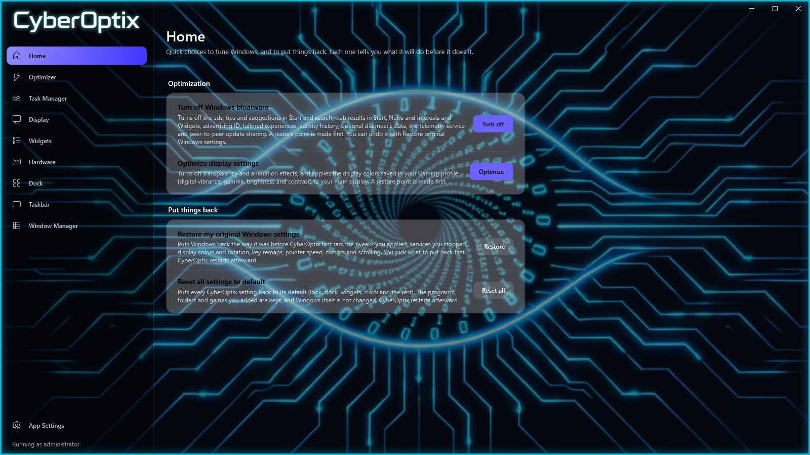 **Home**: optimize, restore, reset | 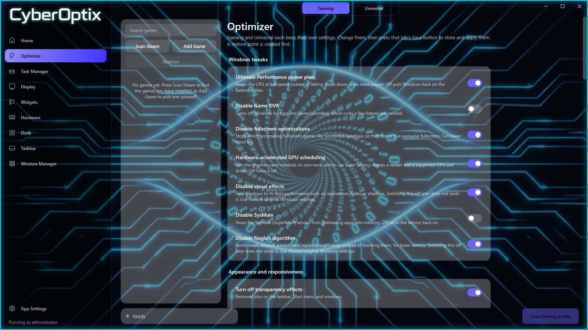 **Optimizer**: Gaming and Universal profiles |
| 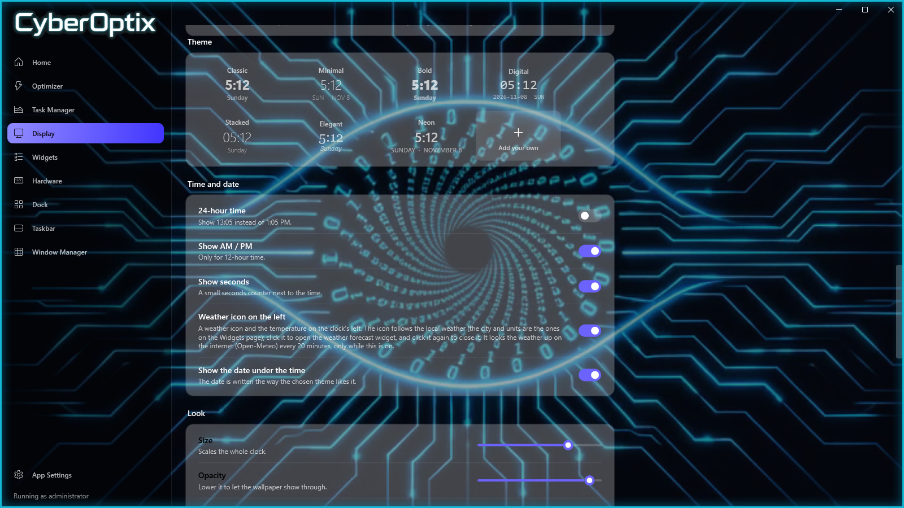 **Desktop Clock**: themes, or add your own | 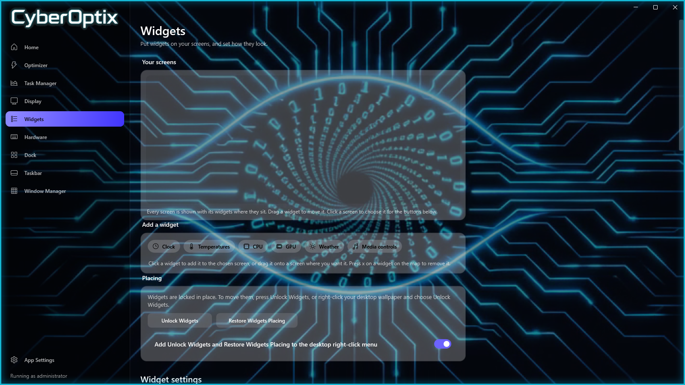 **Widgets**: placed per screen |
| 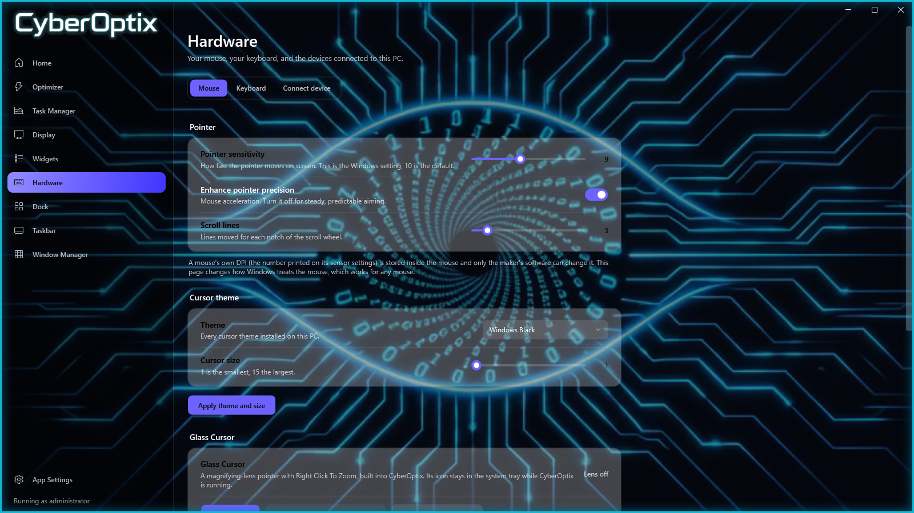 **Hardware**: pointer, cursor, Glass Cursor | 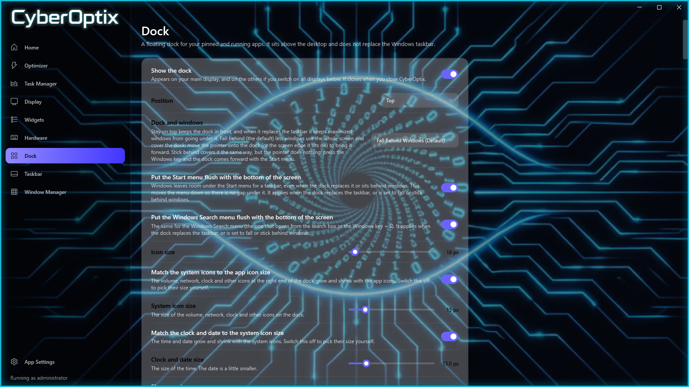 **Dock**: behavior and sizes |
| 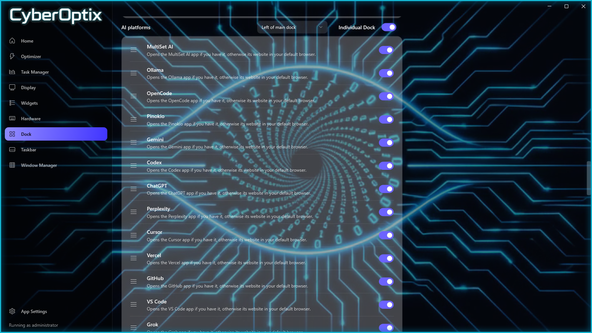 **Dock icons**: drag between docks | 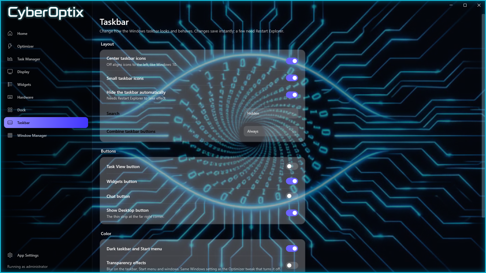 **Taskbar**: Windows' own settings |
| 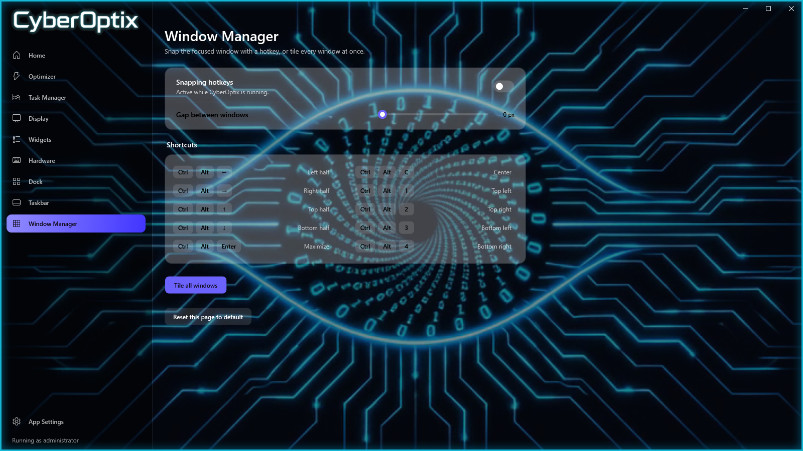 **Window Manager**: snap hotkeys | 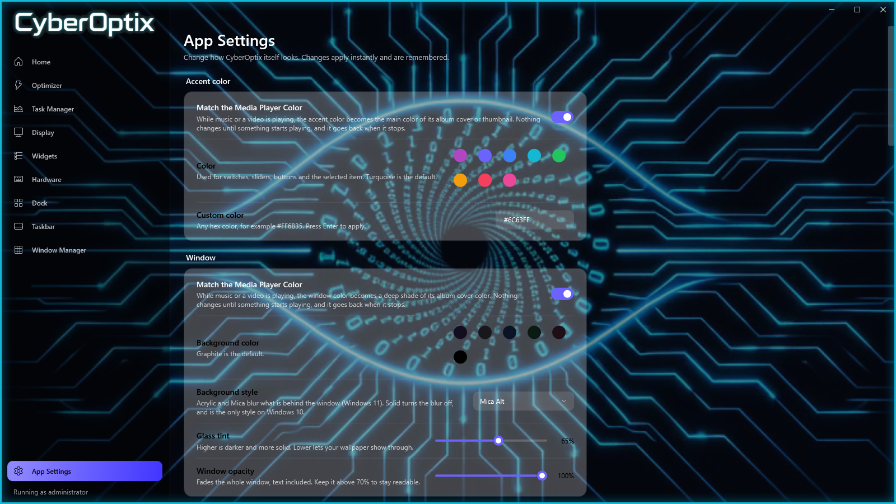 **App Settings**: colors and glow |

The screens are the app's own pages drawn with its default settings, so nothing on them comes from a real PC.

## How it works

- **One app, many windows.** CyberOptix is a single program that runs as administrator. Its main window has a page for each area (Home, Optimizer, Task Manager, Display, Widgets, Hardware, Dock, Taskbar, Window Manager, App Settings). The dock, the desktop clock and the widgets are separate see-through windows it owns, so they stop when you exit it. Closing the main window keeps it in the system tray, so the dock, widgets, hotkeys and Glass Cursor keep working.
- **It changes Windows only when you ask.** Nothing on the Optimizer page is applied while you move switches around. A profile is stored and applied when you press its Save button, and a restore point is made first. Home's buttons and the Taskbar page's switches also act when you press them. Opening the app does not re-apply your Optimizer profile.
- **It remembers how Windows was before it touched anything.** The first time it runs, CyberOptix saves your original registry values, service start modes, power plan, display colors and mouse settings. "Restore original Windows settings" puts back exactly the groups you tick, so you can undo one thing without losing the rest.
- **Your settings are plain data.** Everything CyberOptix itself remembers lives in one JSON file in `%ProgramData%\CyberOptix`, a folder only administrators can change. There are no accounts, no telemetry and no cloud. The only network use is the optional weather lookup.

## Settings: what sticks and what doesn't

**Sticks: CyberOptix saves it and brings it back every launch**
- The look: colors, glass, backdrop, glowing edges, the animated wallpaper, and the "match the media player color" switches.
- The dock: position, how it behaves with windows and apps open, sizes, glow, which icons are on, their order, which dock each icon is in, and where each dock sits.
- The desktop clock (theme, options, color, size, and the spot you dragged it to), your own clock themes, and the live wallpaper if it was running.
- Widgets: which are on, their opacity, the weather city and units, and which media player buttons show.
- The Optimizer's saved Gaming and Universal profiles, the games list, the Task Manager "Never kill" list and the Free up resources choices.
- Hotkeys, Window Manager gap, Glass Cursor settings, and RGB lighting (put back at launch).
- "Use the CyberOptix color for Windows" (App Settings, off by default): sets Windows' accent color so Start, Search, the taskbar and window title bars share your CyberOptix color. Your own Windows colors are saved first and put back when you switch it off or use Restore.
- Start with Windows, start quietly, close to tray and where the window minimizes to.

**Sticks, but Windows is the one keeping it** (CyberOptix changed it once; it does not re-apply it)
- Everything an Optimizer profile or a Home button applied: registry tweaks, services, the power plan, Game DVR, GPU scheduling.
- The Taskbar page's switches, and pointer speed, scrolling, cursor theme and size.
- Key remaps (Windows reads them after a restart).
- These stay until you change them or use Restore original Windows settings.

**Does not stick: starts fresh, or is live**
- **Widget lock.** Widgets always start locked in place. Unlock them to move them, and lock them again.
- **Display colors.** Colors you set on a display are put back at launch, but Windows or the graphics driver can reset them (for example after sleep). Turn on "Do not change my original Windows settings when CyberOptix relaunches" in App Settings and nothing is put back at launch.
- **Colors from the media player.** While something plays, the accent, window, text, card and glow colors can follow the album cover. When it stops they go back to the colors you chose.
- **Unsaved Optimizer changes.** Switches on the Optimizer page are a draft until you press Save.
- **Live information.** The process list, temperatures, CPU and GPU readings and the weather are read fresh. The weather is looked up again every 20 minutes and is never stored.
- **The Windows taskbar while the dock replaces it.** It is hidden only while CyberOptix runs, and comes back when you exit.

Every page has a **Reset this page to default** button, and Home has **Reset all settings to default**, so you never have to reset everything to undo one page.

## Preconfigured settings

CyberOptix's defaults were set up by its author on one PC: an **Intel Core i9-13900K**, an **NVIDIA GeForce RTX 4080 with 16 GB of VRAM** and **32 GB of RAM**. That means:

- The **Optimizer profiles** (Ultimate Performance power plan, fullscreen optimizations off, hardware GPU scheduling on, visual effects off, Nagle's algorithm off, digital vibrance 70, gamma 1.05, ultra low latency and maximum performance power management) are tuned for that kind of fast desktop. On a laptop, a smaller GPU or less memory, look through them before you press Save. Nothing is applied until you do.
- The **dock layout** (app icons 18 px, system icons 15 px, a 13 px clock, the AI, social and system-control icons in their own docks beside the main dock, the dock falling behind windows) was arranged on a large, high-resolution screen. The Dock page changes all of it, and Reset this page to default brings it back.
- The first launch has the dock **replace the Windows taskbar** (and put the Start and Search menus flush with the bottom of the screen). Switch off "Replace the Windows taskbar" on the Dock page if you want the normal taskbar. It returns whenever you close CyberOptix.
- Your own things start empty: no games, no pinned apps, no programs on the Software dock, and the weather city is New York until you set yours.

## Features

### Home
- A Home page with one-click choices: turn off Windows bloatware (ads, suggestions, telemetry), optimize the display settings, restore your original Windows settings, and reset every CyberOptix setting to its default. Each page also has a "Reset this page to default" button that touches only that page's settings, and App Settings has a switch to leave your Windows settings alone when CyberOptix relaunches.

### Optimizer
- Per-game profiles, with a **Scan Steam** button to find installed games or **Add Game** to add one by hand.
- Windows performance tweaks, each with a plain-language explanation of what it does, who it is safe for, and how to undo it by hand. Examples: Ultimate Performance power plan, disable Game DVR, disable fullscreen optimizations, hardware-accelerated GPU scheduling, reduced visual effects, SysMain, Nagle's algorithm, OneDrive and Fast Startup options.
- **Gaming** and **Universal** profiles you can save and switch between.
- Shortcut to the NVIDIA Control Panel.

### Task Manager
Three tabs: **Processes**, **Start-up apps** and **Free up resources**.
- **Processes:** the live monitors sit at the top, then the process list. The monitors show CPU and graphics usage graphs side by side, temperatures, memory (including RAM speed and module details), the apps using the most CPU, GPU and RAM, and case fan control, with data from LibreHardwareMonitor. Any card can be popped out as a floating desktop widget, or all of them at once. Below them, a searchable process list sorted by CPU, memory or name has *End task* and *End task and its child processes*, and every process sits under one of two dividers:
  - **Killable:** safe to end; nothing else in Windows depends on it.
  - **Bloat:** Windows and Microsoft extras that are not needed for anything important, such as telemetry, cloud sync, widgets and updaters.
  Windows, driver and security processes are never listed, and the app refuses to end them even if asked.
- **Start-up apps:** switch apps on or off at Windows start-up.
- **Free up resources:** scans your PC and lists, item by item, the third-party apps and services plus the Windows and Microsoft background services that are safe to stop, with how much RAM each uses and what stopping it does. Nothing is ticked for you, security software, drivers, audio and anti-cheat are never listed, and **restore what was stopped** puts services back afterward. The **Never kill list** button opens a list of running programs: anything you switch on is hidden from Free up resources and skipped even if something tries to stop it.

Sensors and process sampling only run while the tab that needs them is open.

### Display
- Desktop Clock themes can be added with the + tile: a theme is a small JSON file (fonts, sizes, date format), checked and saved in an administrator-only folder, so it can never run anything.
- Per-screen brightness, contrast, gamma, digital vibrance and hue.
- Screen rotation.
- Wallpaper per display, a wallpaper slideshow with shuffle, and live wallpapers from video (MP4), animated GIF or a web page. Live wallpapers can pause automatically while a game or fullscreen app is open.
- A Desktop Clock drawn straight on the wallpaper (no window frame, click-through, behind your apps): the time with the date under it, in seven themes (Classic, Minimal, Bold, Digital, Stacked, Elegant, Neon) with 12/24-hour, seconds, size, opacity, color (including the playing album's color), glow, screen and position options (drag the clock anywhere on a map of your screens), and an optional weather icon on its left that follows the local weather and opens the forecast widget when clicked. Settings pages are made of header cards that drop down to show each group of settings.

### Hardware
- Keyboard key remapping and custom global hot-keys.
- Pointer speed, pointer precision and scrolling controls, plus cursor theme and size.
- **Glass Cursor:** a bundled magnifier/crosshair overlay with a configurable ring, dot and zoom. Every setting (lens mode, sizes, magnification, Right Click To Zoom, colours and keybinds) is on the Hardware page and also in its tray menu. They share one settings file, so a change in either place shows up in the other right away. Glass Cursor is part of CyberOptix, not a separate program: closing the window sends CyberOptix to the system tray (switch this off in App Settings), and the tray icon's Exit CyberOptix quits everything.
- RGB lighting control through Windows dynamic lighting, and a Bluetooth device shortcut.

### Dock and Taskbar
- A custom dock with pinned apps, running apps, system icons (the volume and microphone icons open flyouts with the sound output and input picker, a per-app volume mixer and "Listen to this device"; 44 optional icons such as Weather, Now playing, Display, VPN, Night light, Task Manager and Screenshot can be added; every flyout closes when you click its icon again or click anywhere else) and app panels. The Apps panel can take everything off your desktop (shortcuts, files and folders), put it all back where it came from, and lets you drag the tiles into your own order. The dock can also have a soft glow round its border, in any color you pick.
- Starts with Windows (a scheduled task, so there is no permission prompt at every sign-in) and opens quietly in the system tray. Both can be switched off under Settings, Startup. It can replace the Windows taskbar, can lie behind windows so they use the whole screen (it comes forward when you hover it, or only with the Windows key, and the Start menu can be moved flush with the bottom of the screen), hides while a game is running, and has a panic hot-key (`Ctrl + Alt + T`) that brings the Windows taskbar straight back.
- A Recycle Bin on the dock (empty or full, as Windows shows it): click to open it, right-click to empty it, and drag files, folders or shortcuts onto it to delete them the normal way. They go to the Recycle Bin and can be restored.
- Optional dock icons for apps and websites, grouped as social, streaming and chat, AI platforms, and hardware software (the makers' own apps found on your PC, such as MSI Center, Armoury Crate or iCUE, which each open their app). Each group can have a dock of its own: on any edge of the screen, in a corner, or right beside the main dock. A "System controls" group (Lock this PC, Task Manager, Wallpaper Engine and any program or shortcut you add, such as a restart-to-BIOS tool) is meant for that second dock. A "Software" group holds the CyberOptix icon and any programs, shortcuts or folders you add, and every icon can be dragged by its three-line handle on the Dock page to a new place in its dock, or into another dock. Docks can sit to the left or right of the main dock and line up beside each other in the order you set them.
- Taskbar options: centered or small icons, auto-hide, accent color, transparency, and the search, Task View, chat and Show Desktop buttons.

### Window Manager
- Global snapping hotkeys (`Ctrl + Alt` + key) for halves, quarters and maximize, plus **Tile all windows**.

### Widgets
- A Widgets page with a map of your screens: click a widget (clock, media controls, weather, temperatures, CPU, GPU) to add it to a screen, or drag it onto any screen. A widgets icon on the dock does the same from a small list. Widgets stay clamped where you place them: drag them onto the map of your displays on the Widgets page (or press the Widgets icon on the dock), and they only move after you right-click the desktop and choose Unlock Widgets (Lock Widgets clamps them again, and Restore Widgets Placing puts them back where they were locked). The Widgets window also adds a desktop icon for any tool, Windows settings page, app or website, and opens Windows' own Widgets. They can stay above other windows, change opacity and reset position, and you choose which service buttons the media player shows. An option (off by default) hides the widget windows while a browser or a game is the window in focus.

### Look and feel
- Glass cards, accent color, background color and style, and a custom background picture, all adjustable in App Settings. The default wallpaper is a silent video on a seamless loop (it only plays while the window is on screen, and can be switched off). The default look is a Turquoise accent, a Graphite window, white text and white glass cards. **Match the Media Player Color** (a switch for each of the four, on by default) recolors them, and the dock's border glow, with the main color of the album cover that is playing; nothing changes until something starts playing. The media player widget also appears on the desktop by itself when playback starts, until you close it. It only listens to Windows' media session on this PC and sends nothing anywhere.

### Restore and uninstall
- **Restore original Windows settings** with a checkbox for each group: Windows tweaks, background services, display colors, display rotation, key remaps, pointer speed and precision, scrolling, and cursor theme and size. Anything you leave unticked stays as it is.
- A standalone uninstaller offers the same choices, plus an unticked option to remove the PawnIO sensor driver if you installed it (which you can also do any time in App Settings, under Restore and uninstall).

## Requirements

- Windows 11, or Windows 10 version 2004 (build 19041) or newer. A few things differ on Windows 10: there is no Mica or Acrylic window background (it is solid), and the Taskbar page and the tweaks list show News and interests instead of Widgets, Chat and centred icons. The live wallpaper needs Microsoft's free WebView2 Runtime, which Windows 10 may not have yet.
- Administrator rights. Many tweaks write the registry, change services or run PowerShell, so the app asks for elevation.
- To build from source: the [.NET 8 SDK](https://dotnet.microsoft.com/download/dotnet/8.0).

## Build from source

```powershell
git clone <the repository address>
cd CyberOptix
powershell -ExecutionPolicy Bypass -File .\build.ps1
```

`build.ps1` builds the uninstaller and the app (Glass Cursor is built in as part of it) and writes the result to `publish\CyberOptix.exe`. For a quick development build, `dotnet build src\CyberOptix\CyberOptix.csproj` also works. You can also open `CyberOptix.sln` in Visual Studio.

## Security

CyberOptix runs as administrator, so it is built not to trust files in your profile, and it never sends your data anywhere. See [SECURITY.md](SECURITY.md) for exactly what it does and how to report a problem.

## Privacy and safety

- **No accounts, no telemetry, no analytics.** CyberOptix does not ask you to sign in and does not send usage data anywhere.
- **Network use is limited to two optional things.** The weather (the desktop widget or the dock's weather icon) sends the city name you type to the free [Open-Meteo](https://open-meteo.com/) service (no API key); leave both off and nothing is sent. And the PawnIO sensor driver, only if you click Install on the Monitor page and confirm, is downloaded by Windows' own package manager (winget) from its official source, which checks its checksum.
- Settings and the backup of your original Windows settings are stored locally in `%ProgramData%\CyberOptix`, a folder only administrators can change. Glass Cursor's settings are in `%ProgramData%\CyberOptix\GlassCursor`.
- Tweaks change system settings. CyberOptix keeps your original values so they can be restored, but you should still create a Windows restore point before experimenting, and read what a tweak does before enabling it.

## Project layout

| Path | Contents |
| --- | --- |
| `src/CyberOptix/` | The app. `Pages/` has one screen per section, `Services/` the registry, power, display, hardware, process and desktop logic, `Widgets/` the desktop widgets, dock and live wallpaper windows, `Models/` settings and data types, `Controls/` and `Themes/` the reusable controls and glass theme |
| `src/GlassCursor/` | Glass Cursor (lens, tray and hotkeys), built into CyberOptix as a library |
| `src/Uninstall/` | Source for the standalone uninstaller |
| `docs/` | Design and product notes (`DESIGN.md`, `PRODUCT.md`) |
| `build.ps1` | Builds everything from source |

## Contributing

CyberOptix is open source, and you are welcome to fork it and create your own branches. Only the maintainer can commit to this repository directly. If you want a change included, open a pull request from your fork; nothing is merged without the maintainer's approval.

## Third-party components

- [LibreHardwareMonitor](https://github.com/LibreHardwareMonitor/LibreHardwareMonitor) (MPL 2.0) for sensor data
- [Microsoft WebView2](https://developer.microsoft.com/microsoft-edge/webview2/) for web-page live wallpapers
- [Open-Meteo](https://open-meteo.com/) for weather data
- [simple-icons](https://simpleicons.org/) (CC0) and [LobeHub Icons](https://github.com/lobehub/lobe-icons) (MIT) for the vector logos on the dock's app and website icons. The logos are trademarks of their owners and are used only to label the button that opens that app or site.

## License

Licensed under the [Apache License 2.0](LICENSE).
